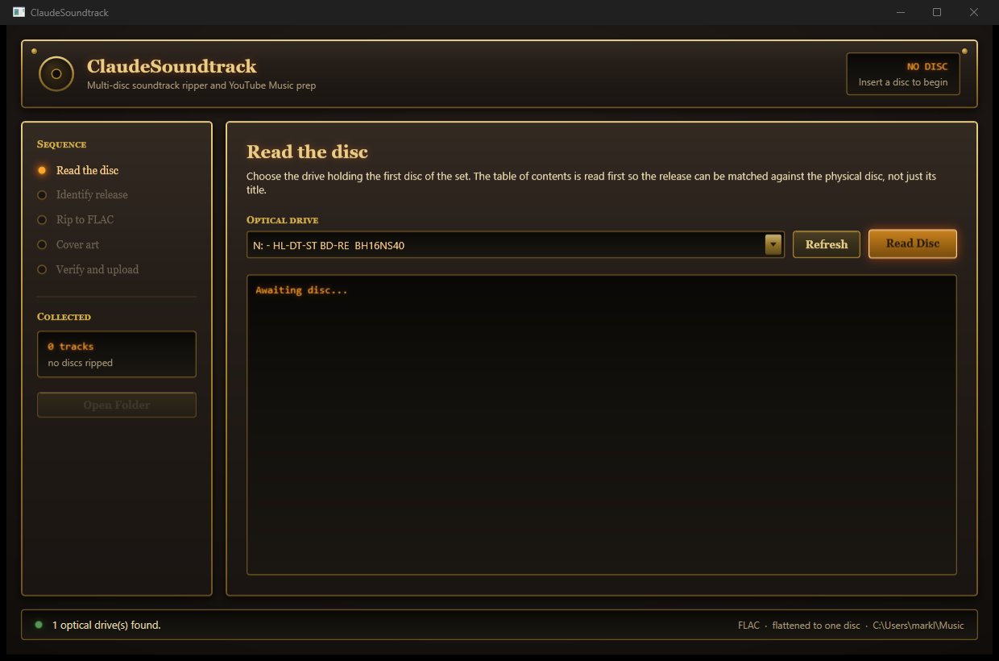
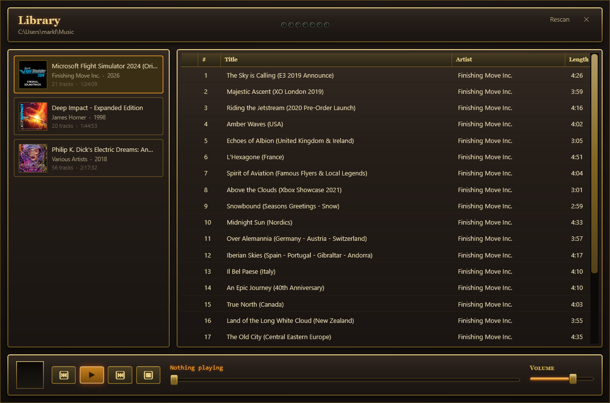

# ClaudeSoundtrack

[](https://github.com/Midcon113/ClaudeSoundtrack/actions/workflows/build.yml)

A Windows 11 app for ripping multi-disc movie soundtracks to FLAC and preparing them for upload to YouTube Music.

Expanded and complete-score releases are the awkward case. They arrive as two, three or four discs, they are limited pressings that metadata services barely cover, and uploading them naively produces a jumbled album: three "track 1"s, or two albums, because the title drifted between discs. ClaudeSoundtrack handles that specific job end to end.





## What it does

- **Rips CD audio to FLAC** with drive read-offset correction and re-reads on damaged sectors. Audio goes straight from the disc into the encoder — no intermediate WAV. Each track's AccurateRip v1 and v2 checksum is computed (the same formula FoxRedbook uses). When accuraterip.com has that pressing, a match is the verification. Limited soundtrack runs usually are not in the database; those tracks are read a second time and the audio is compared. A second read that disagrees fails the readiness check.
- **Flattens a multi-disc set into one album, and keeps the disc number.** Three discs of ten tracks become tracks 1–30. `DISCNUMBER` is the plain integer `1`, `2` or `3` — never `1/2`. `TRACKNUMBER` does not restart. That pairing still plays in the right order if YouTube Music ignores the disc number, and it still plays in the right order if YouTube Music sorts plain disc numbers the way one uploader reported. The disc is not stuffed into the title.
- **Locks the album title and album artist on the first disc.** Later discs cannot rename the set or open a second folder. `ARTIST` and `ALBUMARTIST` are that same album artist on every file. A per-track credit that differs is stored as `PERFORMER`, which YouTube Music does not use to group uploads.
- **Recognises which disc was inserted.** After disc 1, the prompt is "Insert disc 2 of 3" when the release says how many discs there are. The next disc is matched by MusicBrainz disc ID, then by per-track length, and only then by a track count that belongs to exactly one disc. Two discs with the same number of cues are not guessed. If the disc is recognised, the rip starts; if it is not, you set the disc number and press Start Rip.
- **Leaves track numbers out of file names.** `01 - Main Titles.flac` becomes `Main Titles.flac`; the number lives in the `TRACKNUMBER` tag where it belongs. Titles that legitimately begin with a number — *2001: A Space Odyssey*, *633 Squadron* — are left alone.
- **Identifies the release and verifies it against the disc.** Lookup order is MusicBrainz disc ID, then a MusicBrainz table-of-contents lookup, then gnudb (the freedb successor), then Discogs, then CD-Text, then whatever you type. A disc-ID hit is an exact fingerprint. Discogs is text search, so every candidate is checked against the disc's lengths before it is trusted — otherwise a search for an expanded edition happily returns the original album of the same name.
- **Hunts for high-resolution cover art** from the Cover Art Archive first (the pressing MusicBrainz identified), then Discogs, then iTunes. iTunes is labelled as a different-edition risk because it is often a larger picture of the wrong album. You confirm before anything is written, and you can always choose your own file instead. The same bytes are embedded in every track and written beside them as `folder.jpg` or `folder.png`. WebP and other formats YouTube Music cannot display are converted to JPEG once, before that copy is made.
- **Verifies the album before you upload.** Every file is re-read from disk and checked for the things YouTube Music actually needs — including whether the audio is actually *there*, since a failed rip can produce full-length files containing nothing but silence. If it does not pass, a track-by-track tag editor opens instead.
- **Catches the browser's upload dialog** and fills in every track, so uploading is one press of Open rather than navigating a file picker by hand.
- **Browses and plays what you have already ripped**, so a finished album can be checked without leaving the app.
- **Waits in the notification area for a disc**, optionally starting with Windows, and tells you when an audio CD goes in.

Finished albums land in `C:\Users\<you>\Music\<Artist> - <Album> (<Year>)\`.

## Download

Grab `ClaudeSoundtrack.exe` from the [latest release](https://github.com/Midcon113/ClaudeSoundtrack/releases/latest). It is a single self-contained file — no installer, no .NET runtime to install, no DLLs to keep beside it. Put it anywhere and run it.

## Requirements

To rip a disc:

- Windows 11, or Windows 10 version 2004 (20H1) or later
- A CD, DVD or Blu-ray drive that can read audio CDs
- Nothing else to install. The published `.exe` includes the runtime.

To build it yourself, also install the [.NET 10 SDK](https://dotnet.microsoft.com/download/dotnet/10.0). NuGet restores FoxRedbook, the FLAC encoder and the tag library; there is nothing to copy in by hand.

Firefox is only involved if you use the existing direct-upload path, which reads a YouTube Music session cookie out of Firefox. Ripping, tagging and the browser upload do not need it.

## Building

From the repo, in PowerShell or a terminal:

```bash
dotnet build
dotnet test
dotnet run --project src/ClaudeSoundtrack.App
```

There are no local path dependencies — everything comes from NuGet, so a fresh clone builds.

To check the tag logic with no drive and no disc, write a two-disc sample album. This also runs on a machine that is not Windows:

```bash
dotnet run --project src/ClaudeSoundtrack.Sample -- sample-album
```

It writes six FLAC files, `folder.png`, and `sample-report.txt` into `sample-album`. The report is the tags read back off the files. Open one in a tag editor if you want to see `DISCNUMBER` as `1` or `2` and `TRACKNUMBER` running `1` through `6`.

To produce the standalone single-file executable yourself:

```powershell
.\build\publish.ps1
```

It lands in `artifacts\standalone\win-x64\`. Pass `-Runtime win-arm64` for Snapdragon machines. Trimming is deliberately disabled — ATL and the FLAC encoder both resolve types by reflection, and a trimmed build fails at runtime the first time it reads a tag.

## How it is put together

| Project | What it holds |
| --- | --- |
| `src/ClaudeSoundtrack.Core` | Ripping, metadata lookup, artwork search, tagging, flattening, naming, verification. No UI dependencies. |
| `src/ClaudeSoundtrack.App` | WPF interface, dialogs, and the steampunk theme. |
| `tests/ClaudeSoundtrack.Core.Tests` | Unit tests for naming, flattening, disc identification, tag bytes, AccurateRip checksums, and an end-to-end pipeline that encodes real FLAC. A fake drive checks the second-read verification. |
| `src/ClaudeSoundtrack.Sample` | Dry run. Writes a tagged two-disc sample album with no hardware. |

Built on:

- **[FoxRedbook](https://www.nuget.org/packages/FoxRedbook)** — CD-DA drive access, table of contents, offset correction, disc IDs. MIT.
- **[CUETools.Codecs](https://www.nuget.org/packages/CUETools.Codecs)** and **[CUETools.Codecs.Flake](https://www.nuget.org/packages/CUETools.Codecs.Flake)** — managed FLAC encoder. LGPL-3.0. The packages are referenced from NuGet rather than copied into the tree, so they can be replaced with another build of the same library.
- **[ATL.NET](https://www.nuget.org/packages/z440.atl.core)** (`z440.atl.core`) — Vorbis comments and embedded artwork. MIT.
- **[Microsoft.Data.Sqlite](https://www.nuget.org/packages/Microsoft.Data.Sqlite)** — reads Firefox's cookie database for the optional direct upload. MIT.

MusicBrainz, the Cover Art Archive, gnudb, the AccurateRip database and Discogs are queried over HTTP. No SDK is vendored for them. Discogs is used through its API only: a descriptive User-Agent, the documented rate limit (requests are spaced, and a 429 is retried once), and images only for a release you are looking at. Nothing is embedded until you pick it. Cover Art Archive is preferred.

## Notes on the design

A few decisions are worth knowing about before changing anything:

**Metadata matches are verified against the disc, not trusted.** A MusicBrainz disc ID is exact. Otherwise each disc's track lengths are compared with the disc in the drive. Track count is used only when exactly one disc has that many tracks. Two discs of sixteen cues used to both come back as disc 1.

**The album name is fixed once the first disc starts ripping.** A lookup for disc 2 used to overwrite the title, and the new title opened a new folder. YouTube Music then saw two albums, or one folder with only the later disc.

**YouTube Music tags, as far as they can be checked without uploading.** Google's upload help says FLAC is accepted and that metadata and album art travel with the file. It does not name Vorbis keys. From public reports: `TITLE`, `ARTIST`, `ALBUM` and `TRACKNUMBER` are what show up; a differing artist or album string splits an upload into two albums; embedded art is what makes a cover appear, and a loose image file is rejected at upload; a disc number written `1/2` was reported to sort as if the disc number was ignored, while plain `1` and `2` sorted. `ALBUMARTIST` is written as well because users have blamed a missing or differing album artist for splits, but Google has not documented that the field is read. `TRACKTOTAL` and `DISCTOTAL` are separate plain numbers. None of this was confirmed by uploading a file to YouTube Music.

**File names are sanitised, titles are not.** Soundtrack titles are full of characters Windows rejects; a colon in `Suite: Stingers And Act-Out Music` will kill a rip partway through. Only the file name is cleaned — the `TITLE` tag keeps the real punctuation.

**Dropping track numbers from file names reintroduces collisions.** Soundtracks repeat titles constantly, and a set can carry three tracks called `Source Music`. Names are deduplicated across the whole album, including against discs already ripped, so nothing is silently overwritten.

**The readiness check reads the files, not the app's own model.** The failure worth catching is the one where the app believes it wrote something it did not.

## Interface

The look is drawn from oxidised steel control panels with brass fittings and amber lamps. The convention is consistent and worth preserving: brass is structure, amber means active, green means done, and red is reserved for genuine faults.

There is no Windows title bar — the header plate is the caption strip, using `WindowChrome` so dragging, resizing and Aero Snap all still behave normally.

A bank of lamps sweeps across the header while a rip is running; a forty-minute job needs something that reads as alive from across the room. Glow strength, animation and speed are all in Settings, previewed live while you drag the slider.

## Licence

[MIT](LICENSE) — free to use, modify and redistribute, provided the copyright notice is kept.

Copyright © 2026 Mark Lam.
